# Flutter Islamic App 🌙📱
Welcome to the Flutter Islamic App, where technology meets spirituality! Immerse yourself in the beauty of the Quran, stay connected with accurate prayer times, explore Hadith, and more. With YouTube integration, multiple themes, and seamless localization, this app is your go-to companion for a enriched Islamic experience. Dive in and embark on a journey of faith and knowledge! 🚀✨
<br/>
##   التطبيق الاسلامى
هذا التطبيق الاسلامى يحتوى على القران كاملا،الاحاديث الاربعين النووية،مواقيت الصلاة،الاذكار،الادعية و أركان الاسلام الخمسة.
التطبيق يحتوى على اضافات عديدة منها تشغيل الفديوهات من اليوتيوب ، البحث عن اى كلمة فى القران ، تعدد اللغات و امكانية تفعيل الوضع الليلى و اضافات اخرى. 


## State Management
- **Cubit:** Utilizing Cubit for efficient and organized state management. 


## Features

### Clean Architecture
Built on a foundation of Clean Architecture, the Flutter Islamic App ensures a modular and maintainable codebase, promoting scalability and robustness.

### Dependency Injection
Utilizing Dependency Injection for efficient management and organization of services, the app ensures a streamlined and easily maintainable structure.

### Responsive Design
Experience a seamless transition between portrait and landscape modes with a Responsive Design. The app adapts fluidly to different screen orientations, providing a consistent and user-friendly experience.

### Complete Quran
Immerse yourself in the divine words with the entire Quran available at your fingertips. Search for specific verses and explore the beauty of the Holy Book.

### Prayer Times API
Never miss a prayer again with accurate prayer times based on your location. Stay connected to your faith throughout the day.

### Hadith
Delve into the wisdom of the Prophet with the Hadith feature, providing you with insightful teachings and their explanations.

### Azkar
Keep your heart connected to Allah through a collection of Azkar and Duas. Enhance your spiritual journey with these supplications.

### Five Pillars of Islam
Understand and practice the core principles of Islam with information on the Five Pillars.

### YouTube Integration
Explore a curated list of YouTube videos to enrich your knowledge and understanding. You can also play any YouTube video within the app.

### Search Quran
Effortlessly search for any word or phrase within the Quran. Access specific verses and deepen your understanding.

### Localization
Choose between Arabic and English languages to experience the app in the language that resonates with you.

### Multiple Themes
Customize your app experience with multiple themes, ensuring a visually pleasing interface that suits your preferences.

### Bookmarks and Azkar Management
Bookmark your favorite verses or save Azkar for quick access. Personalize your experience and create a spiritual space tailored to your needs.
<br />

## Dependencies

Explore the list of dependencies that contribute to the seamless functionality of the app:

- **`youtube_player_flutter`**: A Flutter plugin for embedding YouTube videos. Enhance your app with the ability to play YouTube videos seamlessly.

- **`dots_indicator`**: A simple yet customizable package for displaying indicators for PageViews. Perfect for indicating the current position in image carousels or onboarding screens.

- **`flutter_svg`**: Allows you to display SVG files in Flutter. Bring vector graphics into your app for a polished and scalable user interface.

- **`build_runner`**: A tool to generate files at build-time. Utilized for code generation in the Flutter app to streamline development.

- **`dartz`**: Functional programming in Dart. It provides immutable data types and functional programming tools, enhancing code reliability and readability.

- **`shared_preferences`**: A Flutter plugin for reading and writing simple key-value pairs. Ideal for storing and retrieving lightweight app preferences.

- **`get_it`**: A simple Service Locator for Dart and Flutter projects. Efficiently manage and access services throughout the app.

- **`easy_localization`**: A Flutter package for easy localization of your app. Support multiple languages effortlessly.

- **`flutter_phoenix`**: A Flutter plugin to gracefully restart your app. Useful for refreshing the app state without a full restart.

- **`flutter_bloc`**: A state management library for Flutter applications. Implement the BLoC (Business Logic Component) pattern to manage state efficiently.

- **`equatable`**: A Dart library for value-based equality. Simplifies equality comparisons in Dart applications.

- **`flutter_screenutil`**: A Flutter adaptation of the ScreenUtil plugin, providing a simple way to adapt screen sizes.

- **`conditional_builder_null_safety`**: A package for conditional widget building based on a condition. Enhances widget composition based on runtime conditions.

- **`json_serializable` & `json_annotation`**: Dart libraries for JSON serialization. Convert Dart objects to and from JSON effortlessly.

- **`floor` & `floor_generator`**: A persistence library for Flutter that simplifies database operations. Utilize SQLite for efficient data storage.

- **`sqlite3_flutter_libs`**: SQLite3 native bindings for Flutter. Enables SQLite database functionality in Flutter apps.

- **`retrofit` & `retrofit_generator`**: A type-safe HTTP client for Flutter and Dart. Simplifies API interactions by generating code based on annotated Dart classes.

- **`dio`**: A powerful HTTP client for Dart, providing features like request/response interception, FormData, and more.

- **`pretty_dio_logger`**: A Dio interceptor for logging HTTP requests and responses. Enhances debugging and troubleshooting during API interactions.

- **`internet_connection_checker`**: A Dart package for detecting internet connectivity. Ensure a reliable internet connection for your app's functionality.

- **`location` & `geocoding`**: Flutter plugins for accessing device location and geocoding services. Integrate location-based features seamlessly.

- **`wakelock`**: A Flutter plugin for preventing the device from sleeping. Useful for keeping the screen awake during specific app interactions.

- **`url_launcher`**: A Flutter plugin for launching URLs. Open external links in the default browser or other installed apps.

- **`google_fonts`**: A Flutter package for accessing Google Fonts. Enhance your app's typography with a wide selection of fonts.

- **`sqflite`**: A Flutter plugin for SQLite databases. Enable structured and persistent data storage in your app.

### Demo Video
<a href="https://youtu.be/GxJ1lFVL3W8"></img></a>
<br />

### Download App
<a href="https://github.com/mo7amedaliEbaid/islamic/releases/download/v1.0.0/islamic.apk"></img></a>

### Screen Shots
For more screen shots [Here](https://github.com/mo7amedaliEbaid/islamic/blob/5236b4010cb4f9b09eeef87f444d11b23e418654/islamic_screenshots)

##### Portrait

<br />
<p float="left">
   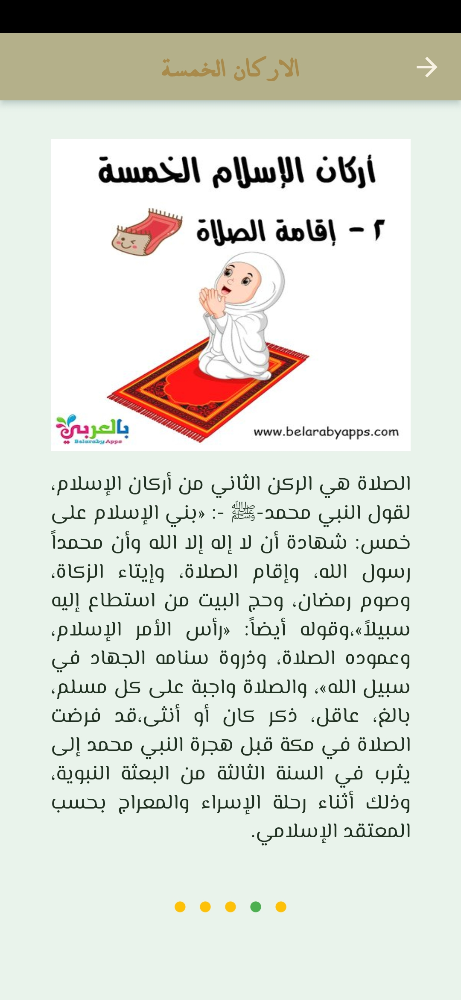
   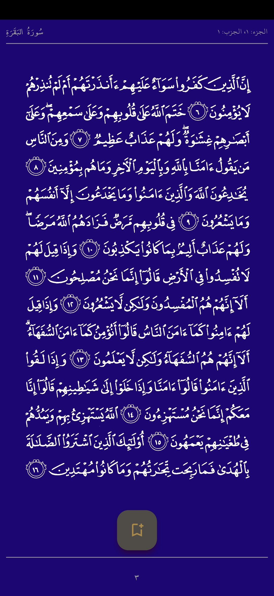
   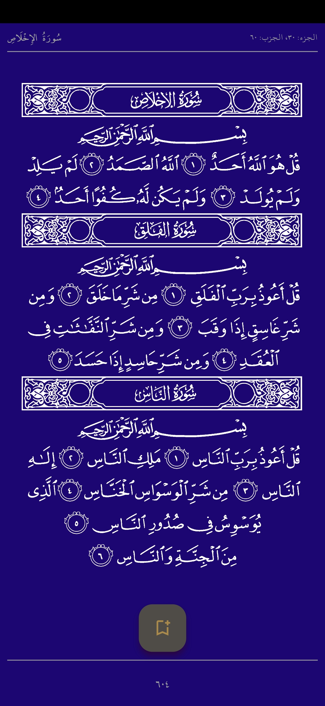
   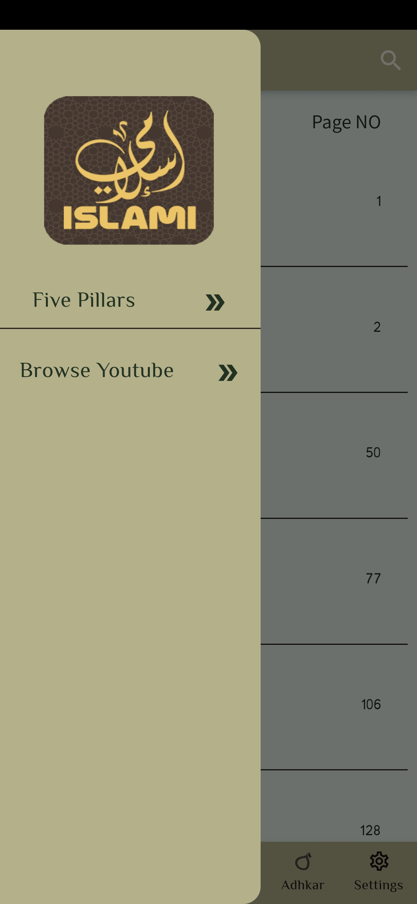
   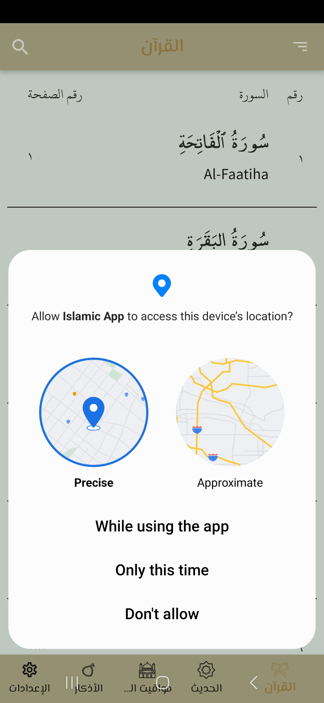
   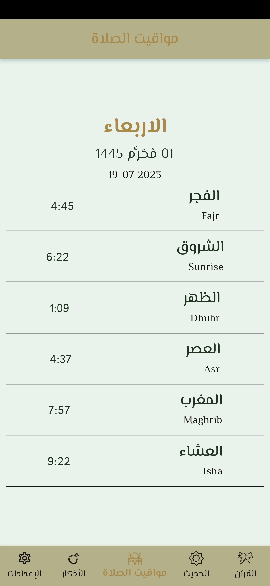
   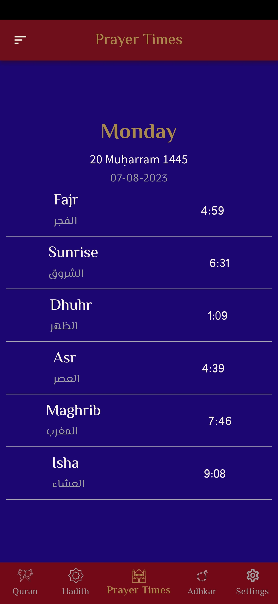
   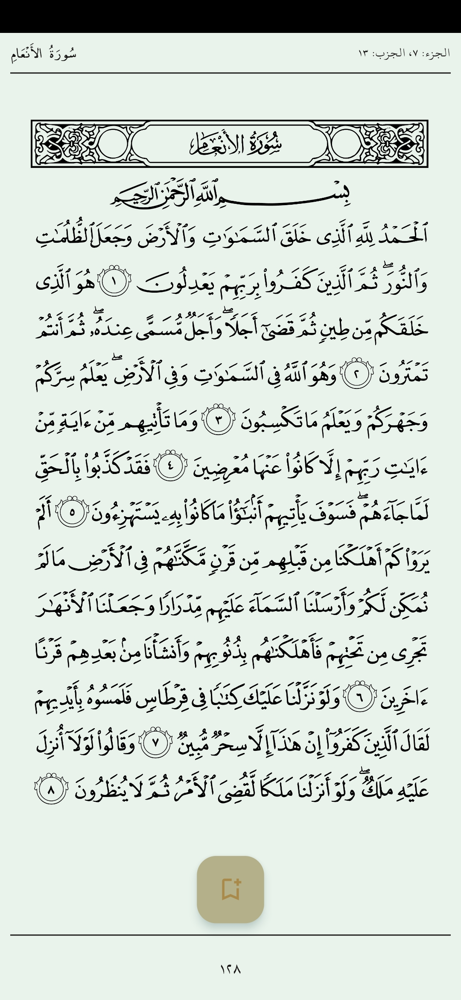
   
   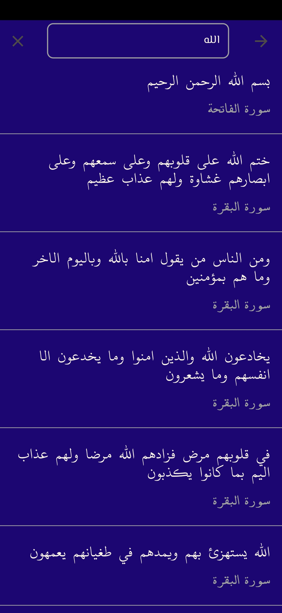
   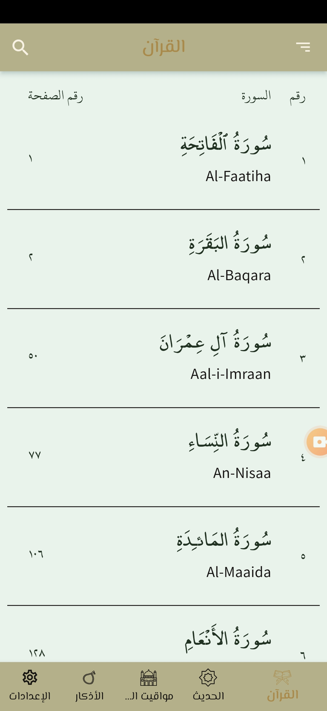
   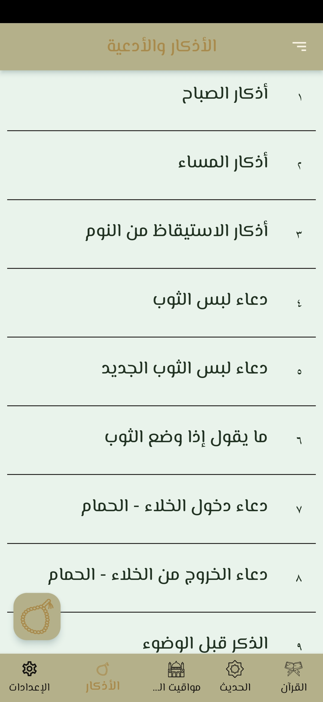
   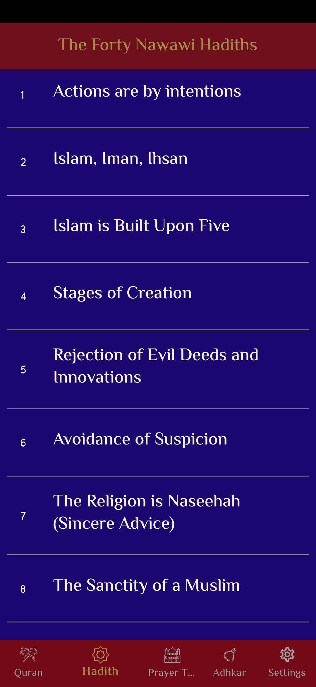
   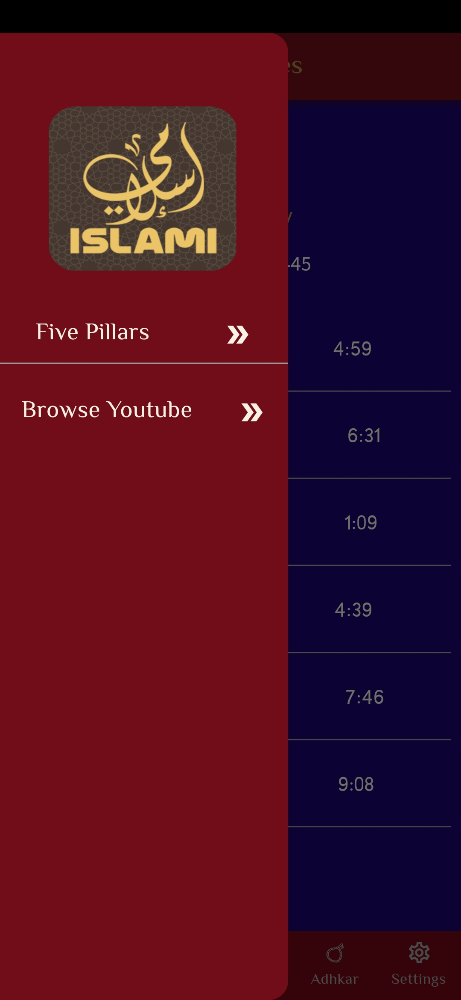
   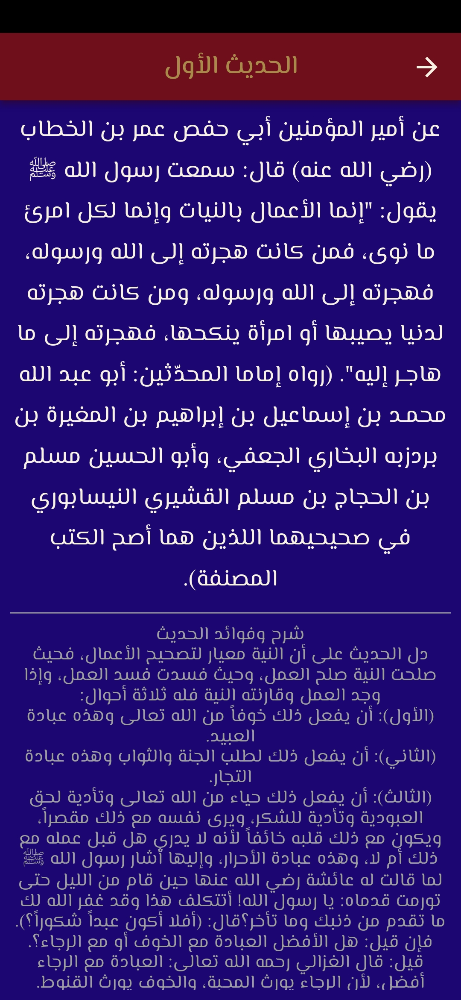
   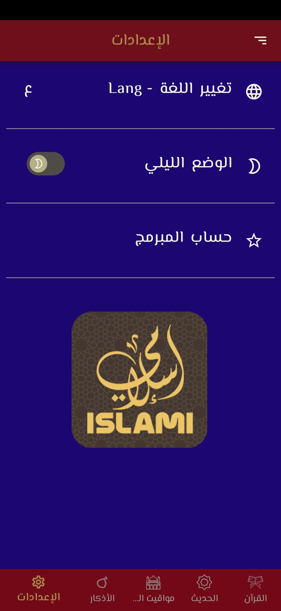
   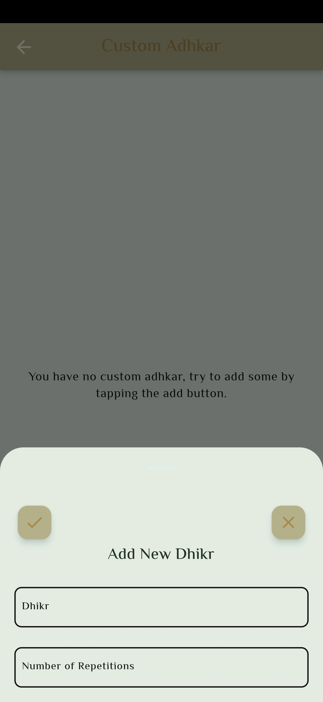
   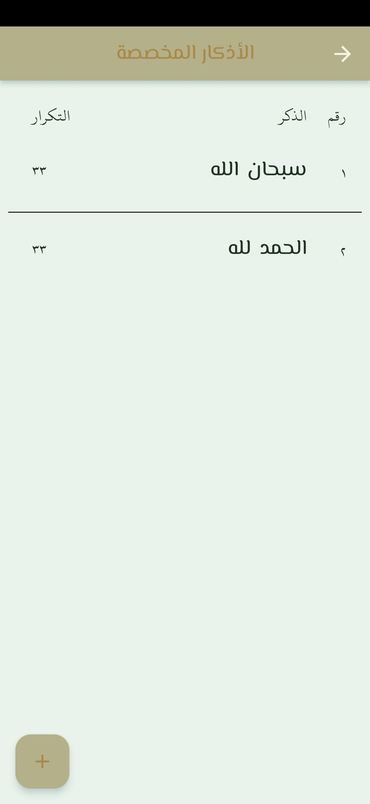
</p>

##### Landscape 

<p float="left">
   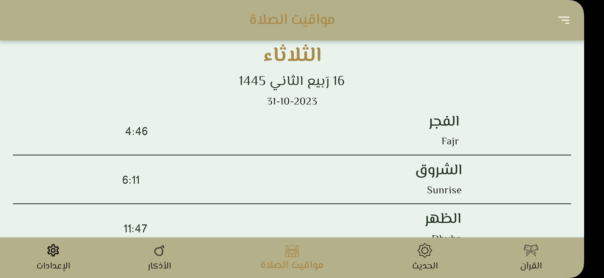
   
   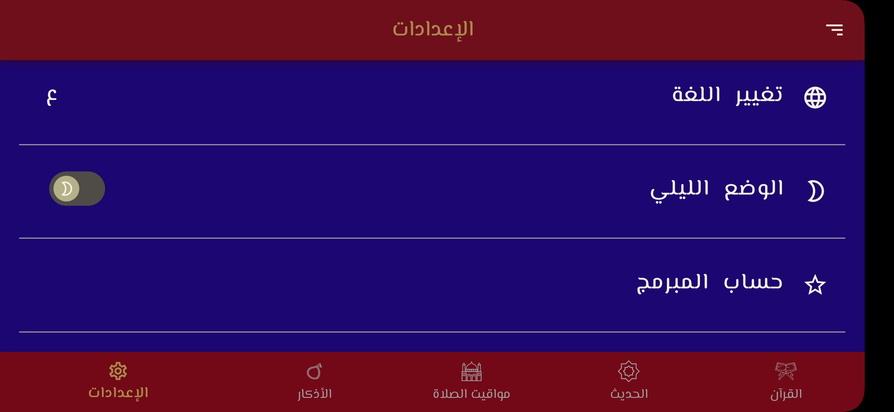
</p>

## How to Use

Follow these steps to get started with the app:

1. Clone the repository.
2. Install dependencies using the provided `pubspec.yaml` file.
3. Run the app on your Flutter-compatible device.

## Run Guidelines

To ensure compatibility, this project requires **Flutter 3.10.6**.

### 1. Download Flutter SDK (Version 3.10.6)

| OS      | Download Link |
| :------ | :------------ |
| **macOS** | [flutter_macos_3.10.6-stable.zip](https://storage.googleapis.com/flutter_infra_release/releases/stable/macos/flutter_macos_3.10.6-stable.zip) |
| **Windows** | [flutter_windows_3.10.6-stable.zip](https://storage.googleapis.com/flutter_infra_release/releases/stable/windows/flutter_windows_3.10.6-stable.zip) |
| **Linux** | [flutter_linux_3.10.6-stable.tar.xz](https://storage.googleapis.com/flutter_infra_release/releases/stable/linux/flutter_linux_3.10.6-stable.tar.xz) |

### 2. Setup & Run
1.  Download and extract the Flutter SDK to a location of your choice.
2.  Run the app using the absolute path to this specific Flutter version:

```bash
# macOS / Linux
<path-to-flutter-sdk>/bin/flutter run

# Windows (Command Prompt / PowerShell)
<path-to-flutter-sdk>\bin\flutter run
```

*Note: You may also need to configure `android/local.properties` to point `flutter.sdk` to this specific version.*
